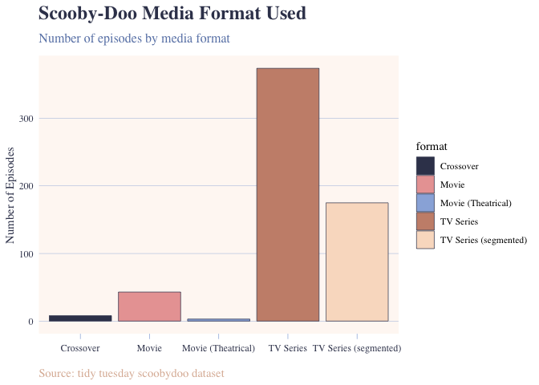

<!-- README.md is generated from README.Rmd. Please edit that file -->

<p align="center">


</p>

<h1 align="center">

Unmasking the Data
</h1>

<p align="center">

Exploring Data with R
</p>

<p align="center">

Unmask your data with simple data manipulation functions and a custom
plotting theme!
</p>

<!-- badges: start -->

<!-- badges: end -->

## Overview

The unmasked package provides a way to make data exploration,
summarization, and visualization easier and more approachable. By
combining workflow moves and functions to calculate group percentages
and organize the data, unmasked helps to uncover patterns in the data
and clearly communicate the findings.

Whether you’re exploring a new data set, completing a class assignment,
or creating a polished vizualization, unmasked offers you the
opportunity to do more with your data.

## Why use unmasked?

Summarizing observations, calculating percentages, and formatting plots
often become a repetive and time consuming process. With unmasked, this
process is made much simpler by bringing together helpful functions and
a custom theme.

- **Simplify data exploration**: Work with a data set using simple data
  moves to manipulate and explore the data.
- **Calculate group percentages**: Use the helper function
  `percent_by_group()` to examine how much each group contributes to the
  total.
- **Create clean visualizations**: Use the theme function `theme_trap()`
  to organize the data and create consistent and pleasing visualizations
  with a soft pastel color palette.
- **Make findings easier to communicate**: Combine the data summaries
  and visualizations to professionally present your findings of the
  data.

## Installation

You can install the development version of unmasked from
[GitHub](https://github.com/) with:

``` r
# install.packages("pak")
pak::pak("icl003/unmasked")
```

Load the package with: `library(unmasked)`

## Main Functions

### percent_by_group()

The `percent_by_group()` function calculates the number of observations
in each category of a specific variable and gives the percentage of the
total that this number represents. This is useful for quickly
understanding the distribution of a categorical variable with out having
to write out all of the calculations.

For example, using the scoobydoo data set from Tidy Tuesday:

``` r
library(tidytuesdayR)
library(unmasked)

tuesdata <- tidytuesdayR::tt_load(2021, week = 29)
#> ---- Compiling #TidyTuesday Information for 2021-07-13 ----
#> --- There is 1 file available ---
#> 
#> 
#> ── Downloading files ───────────────────────────────────────────────────────────
#> 
#>   1 of 1: "scoobydoo.csv"
scoobydoo <- tuesdata$scoobydoo

percent_by_group(scoobydoo, network)
#> 
#> Attaching package: 'dplyr'
#> 
#> The following objects are masked from 'package:stats':
#> 
#>     filter, lag
#> 
#> The following objects are masked from 'package:base':
#> 
#>     intersect, setdiff, setequal, union
#> # A tibble: 11 × 3
#>    network                  n percent
#>    <chr>                <int>   <dbl>
#>  1 ABC                    281  46.6  
#>  2 Adult Swim               1   0.166
#>  3 Boomerang               74  12.3  
#>  4 CBS                     49   8.13 
#>  5 Cartoon Network         84  13.9  
#>  6 Syndication              3   0.498
#>  7 TBC                      1   0.166
#>  8 The CW                  27   4.48 
#>  9 The WB                  41   6.80 
#> 10 Warner Bros. Picture     3   0.498
#> 11 Warner Home Video       39   6.47
```

We used the function to explore how episodes are distributed across
different networks, since both the count and percentage are provided for
each network.

### theme_trap()

The `theme_trap()` function provides a theme with a simple, clean,
consistent layout, with a soft pastel-like aesthetic. It focuses on
blues, using navy for next, a lighter blue for graph lines and
highlights, as well as a complementary light peach background to tie the
graph together. These colors come from the brand, which uses a similar
color palette focused on blues but also includes peaches and browns
which all tie together nicely.

For example, using the scoobydoo data set from Tidy Tuesday:

``` r
library(tidytuesdayR)
library(unmasked)
library(ggplot2)

tuesdata <- tidytuesdayR::tt_load(2021, week = 29)
#> ---- Compiling #TidyTuesday Information for 2021-07-13 ----
#> --- There is 1 file available ---
#> 
#> 
#> ── Downloading files ───────────────────────────────────────────────────────────
#> 
#>   1 of 1: "scoobydoo.csv"
scoobydoo <- tuesdata$scoobydoo

ggplot(scoobydoo, aes(x = format, fill = format)) +
  geom_bar(
    color = "#3A405A",
    linewidth = 0.25
  ) +
  scale_fill_manual(
    values = c(
      "#3A405A",
      "#E9A4A3",
      "#99B2DD",
      "#C98F7A",
      "#F9DEC9"
    )
  ) +
  labs(
    title = "Scooby-Doo Media Format Used",
    subtitle = "Number of episodes by media format",
    x = NULL,
    y = "Number of Episodes",
    caption = "Source: tidy tuesday scoobydoo dataset"
  ) +
  theme_trap()
```



Applying the theme function gives a consistent and clean visual layout
that avoids non-data-ink without all the additional manual coding.

## Exploring the Scooby-Doo dataset

The unmasked package can be used with dplyr to investigate different
datasets. Here, we used the scoobydoo data set to look at examples.
Using this dataset, you can explore questions such as:

- Which episodes feature real monsters?
- How many episodes fall into each monster category?
- Which episodes have the longest run times?
- How are episodes distributed across networks and media formats?

For example, with scoobydoo data set from Tidy Tuesday, you can filter
the episodes featuring real monsters:

``` r
library(dplyr)

scooby_filtered <- scoobydoo %>%
  filter(monster_real == TRUE)
```

Where we now have a filtered data set which only includes episodes where
the monster was identified as real.

We can also group episodes by whether or not the monster was real, and
provide a summary count of the episodes in each group.

``` r
library(dplyr)

scooby_groupby <- scoobydoo %>%
  group_by(monster_real) %>%
  summarize(episode_count = n())
```

These examples portray how the unmasked package fits into a larger data
workflow, and is able to complement simple data move dplyr functions
with convenient summary and visualization tools.

## Dependencies

The examples in this README use these R packages:

- `dplyr` for data manipulation
- `ggplot2` for visualizations
- `tidytuesdayR` to access the scoobydoo dataset used in the examples

You can install these with:

`install.packages(c("dplyr", "ggplot2", "tidytuesdayR"))`

## Documentation

For a more detailed outline of the entire package, visit the vignette,
which goes through every type of data move, as well as in depth
explanations of both the helper and theme functions using the scoobydoo
dataset.

## Contributing

Suggests and feedback are welcome, so if any issues arise or any ideas
for improvement, feel free to open an issue in the GitHub repository.

## License

This package is licensed under the MIT License. See the LICENSE file for
details.
